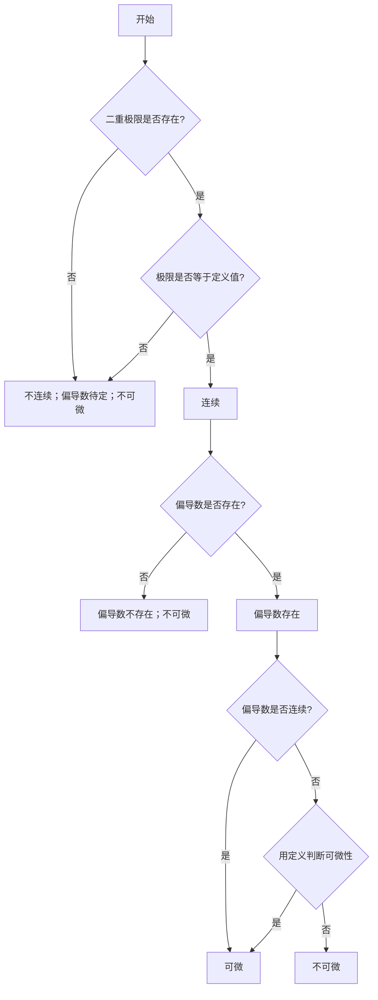

**内部资料，禁止传播
编委会(不分先后，姓氏首字母顺序): 程奕铭 王霏 张容博 郑哲航**

---
## 1. 多元函数的极限与连续

### 1.1 知识点

>[!info] 定义$\qquad$二重极限
>设函数 $z=f(x,y)$ 在点 $P_0(x_0,y_0)$ 的某去心邻域内有定义。若存在常数 $A$，对于任意给定的正数 $\varepsilon$，总存在正数 $\delta$，使得当 $0<\sqrt{(x-x_0)^2+(y-y_0)^2}<\delta$ 时，都有 $|f(x,y)-A|<\varepsilon$，则称 $A$ 为函数 $f(x,y)$ 当 $(x,y)\to(x_0,y_0)$ 时的极限，记作：
  $$\lim_{(x,y)\to(x_0,y_0)} f(x,y) = A \quad \text{或} \quad \lim_{\substack{x \to x_0 \\ y \to y_0}} f(x,y)=A$$

- **二重极限与累次极限的区别**：
  - 二重极限：$(x,y)$ 以任意方式同时趋于 $(x_0,y_0)$，记作 $\lim_{(x,y)\to(x_0,y_0)} f(x,y) = A$
  - 累次极限：$\lim_{x\to x_0}(\lim_{y\to y_0} f(x,y))$ 或 $\lim_{y\to y_0}(\lim_{x\to x_0} f(x,y))$
  - **区别**：二重极限存在要求沿**任意路径**趋近时极限值都相等，而累次极限仅考虑沿坐标轴方向的两次一元极限。
  - **联系：** 如果三个极限都存在，则三者相等；仅知其中一个存在，无法推出其他两个存在

>[!info] 定义$\qquad$连续
>若$\displaystyle\lim_{(x,y)\to(x_0,y_0)} f(x,y) = f(x_0,y_0)$，则称 $f(x,y)$ 在点 $(x_0,y_0)$ 处连续。

- **有界闭区域上连续函数的性质**：
  - **有界性定理**：函数在闭区域上有界
  - **最值定理**：函数在闭区域上必能取到最大值与最小值
  - **介值定理**：函数在有界闭连通区域上能取到介于最大值与最小值之间的任何值
### 1.2 常见题型及应对策略
1. **证明极限不存在**：
   **路径法**：选取两条不同的路径(如 $y=kx$，$y=x^2$)，若得到不同的极限值，则二重极限不存在。
2. **证明二元函数不连续：**
	找到一种路径接近 $(x_0,y_0)$时，值不等于 $f(x_0,y_0)$
3. **求极限值**：
   - 利用极限运算法则与无穷小性质
   - **夹逼准则**：通过放缩找到上下界函数
   - **极坐标代换法**（常用）：令 $x = r\cos\theta, y = r\sin\theta$，将 $(x,y)\to(0,0)$ 转化为 $r\to 0^+$。若极限值与 $\theta$ 无关，则极限存在且等于该值。
### 1.3 经典例题

>[!example] 例1
>（21春T2） 已知二元函数 $\displaystyle f(x, y) = \frac{x^2 y^2}{x^2 y^2 + (x - y)^2}$，则（）。
(A) 二重极限 $\displaystyle \lim_{\substack{x \to 0 \\ y \to 0}} f(x, y)$ 存在，且 $\displaystyle \lim_{x \to 0} \lim_{y \to 0} f(x, y) = 0$
(B) 二重极限 $\displaystyle \lim_{\substack{x \to 0 \\ y \to 0}} f(x, y)$ 存在，且 $\displaystyle \lim_{x \to 0} \lim_{y \to 0} f(x, y) = 1$
(C) 二重极限 $\displaystyle \lim_{\substack{x \to 0 \\ y \to 0}} f(x, y)$ 不存在，但 $\displaystyle \lim_{x \to 0} \lim_{y \to 0} f(x, y) = 0$
(D) 二重极限 $\displaystyle \lim_{\substack{x \to 0 \\ y \to 0}} f(x, y)$ 不存在，但 $\displaystyle \lim_{x \to 0} \lim_{y \to 0} f(x, y) = 1$

>[!solution] **解：**
>**解题思路 ：**
>1. **累次极限计算** 先固定 $x$，令 $y \to 0$： $$\lim_{y \to 0} \frac{x^2 y^2}{x^2 y^2 + (x-y)^2} = 0$$ 再令 $x \to 0$，得 $\displaystyle\lim_{x \to 0}\lim_{y \to 0} f(x,y) = 0$。
>2. **二重极限判断（路径法）** 二重极限存在的必要条件：沿任意路径趋近原点，极限值一致。
>- 沿 $y=0$ 趋近：极限为 $0$
>- 沿 $y=x$ 趋近：$f(x,x)=\frac{x^4}{x^4}=1$，极限为 $1$ 两条路径极限值不相等，因此二重极限不存在。 
>**答案**： $\boldsymbol{C}$

---
## 2. 偏导数与全微分

### 2.1 基础知识点

>[!info] **偏导数的定义**：
  $$f_x(x_0,y_0) = \lim_{\Delta x\to 0} \frac{f(x_0+\Delta x, y_0) - f(x_0,y_0)}{\Delta x}$$
  $f_y(x_0,y_0)$ 的定义类似。

- **偏导数的几何意义**：$f_x(x_0,y_0)$ 是曲面 $z=f(x,y)$ 被平面 $y=y_0$ 所截得的曲线在点 $M_0$ 处的切线对 $x$ 轴的斜率。

>[!info] **全微分的定义**：
>若函数 $z=f(x,y)$ 在点 $(x,y)$ 的全增量可表示为：
  $$\Delta z = A\Delta x + B\Delta y + o(\rho)$$
  其中 $\rho = \sqrt{(\Delta x)^2+(\Delta y)^2}$，$A,B$ 不依赖于 $\Delta x,\Delta y$，则称 $f(x,y)$ 在该点**可微**，且全微分为 $dz = A\,dx + B\,dy$。

>[!hint] **重点：可微的判定条件**
> - **必要条件**：可微 $\implies$ 偏导数存在，且 $A=f_x, B=f_y$
> - **充分条件**：若偏导数 $f_x, f_y$ 在点 $(x_0,y_0)$ 的某邻域内存在，并且在 $(x_0,y_0)$ 处连续，则函数在该点可微
> - 偏导数存在 $\nRightarrow$ 可微（反之成立）

- **全微分的计算公式**：$$\mathrm dz = \frac{\partial z}{\partial x}\mathrm dx + \frac{\partial z}{\partial y}\mathrm dy$$
>[!warning] 警告！
>请在确认函数 $f(x,y)$ 在该点可微后再使用全微分公式。

### 2.2 常见题型及应对策略
1. **求显函数的偏导数**：将**其他自变量视为常数**，使用一元函数求导法则。
2. **判断可微性**：
   - 步骤1：检查偏导数 $f_x, f_y$ 是否存在。若不存在则不可微。
   - 步骤2：计算极限 $\lim_{\rho\to0} \frac{\Delta z - f_x\Delta x - f_y\Delta y}{\rho}$ 是否为 $0$。若为 $0$ 则可微。
   - 步骤3（简便方法，利用充分条件）：若偏导数在该点连续，则直接得出可微。
3. **近似计算**：利用公式 $f(x_0+\Delta x, y_0+\Delta y) \approx f(x_0,y_0) + f_x(x_0,y_0)\Delta x + f_y(x_0,y_0)\Delta y$。
### 2.3 经典例题
>[!example] 例2
> 设 $\displaystyle f(x,y) = \begin{cases} \frac{xy}{x^2+y^2}, & (x,y)\neq(0,0) \\ 0, & (x,y)=(0,0) \end{cases}$，讨论 $f(x,y)$ 在 $(0,0)$ 处的偏导数存在性与可微性。

>[!solution] 解
>偏导数存在性：
>$$f_x(0,0) = \lim_{\Delta x\to0} \frac{f(\Delta x,0)-0}{\Delta x} = 0$$
>同理 $f_y(0,0)=0$。故偏导数存在。
>可微性：若 $f$ 在 $(0,0)$ 处可微，则必在该点连续。但沿路径 $y=x$ 趋近原点时，
>$$f(x,x)=\frac{x^2}{2x^2}=\frac12$$
>而 $f(0,0)=0$，故 $f$ 在 $(0,0)$ 处不连续，因此不可微。
>
>也可用定义验证：
>$$\frac{f(\Delta x,\Delta y)-f(0,0)-f_x(0,0)\Delta x-f_y(0,0)\Delta y}{\rho}
=\frac{\Delta x\Delta y}{\big((\Delta x)^2+(\Delta y)^2\big)\sqrt{(\Delta x)^2+(\Delta y)^2}}$$
>取路径 $\Delta x=\Delta y=t$，上式为
>$$\frac{t^2}{2t^2\cdot\sqrt2|t|}=\frac{1}{2\sqrt2|t|}$$
>当 $t\to0$ 时发散，故极限不存在。
>
>**结论**：偏导数存在但函数不可微。

>[!example] 例3
>求 $z = x^y\ (x>0)$ 的全微分。

>[!solution] 解
> $\displaystyle\frac{\partial z}{\partial x} = yx^{y-1}$（将 $y$ 视为常数）
>  $\displaystyle\frac{\partial z}{\partial y} = x^y \ln x$（将 $x$ 视为常数）
>  $\displaystyle\mathrm dz = yx^{y-1}\,\mathrm dx + x^y\ln x\,\mathrm dy$

### 2.4 二元函数在一点性质的判定流程

本流程适用于形如

$$
f(x,y) = 
\begin{cases} 
\dfrac{P(x,y)}{Q(x,y)}, & (x,y) \neq (0,0) \\[4pt]
0, & (x,y) = (0,0)
\end{cases}
$$

的二元函数在原点的性质判定。建议依次检查：**极限** $\rightarrow$ **连续性** $\rightarrow$ **偏导数存在性** $\rightarrow$ **偏导数连续性** $\rightarrow$ **可微性**。每一步的结果都会影响后续判断。

---

#### 步骤一：判断二重极限是否存在

**方法：**

1. **路径试探法**：令 $(x,y)$ 沿不同路径趋近于 $(0,0)$。
   - 常见路径：$y = kx$，$y = kx^2$，$x = 0$，$y = 0$，$y = x^\alpha$ 等。
   - 如果两条路径得到的极限值不同，则二重极限不存在。
2. **极坐标代换**：令 $x = r\cos\theta$，$y = r\sin\theta$，$r \to 0^+$。
   - 若能证明所得表达式当 $r\to0^+$ 时趋于某个与 $\theta$ 无关的常数，则二重极限存在。
3. **夹逼准则**：用绝对值放缩，找到
   $$0 \le |f(x,y)| \le h(x,y),\qquad h(x,y)\to0.$$

**判定结论：**

- **极限不存在** $\Rightarrow$ 直接得到：**不连续、不可微**。（偏导数可能存在也可能不存在，需单独检查。）
- **极限存在且等于定义值** $\Rightarrow$ 函数连续，进入下一步。

---

#### 步骤二：判断连续性

函数在 $(0,0)$ 连续的充要条件为

$$
\lim_{(x,y)\to(0,0)} f(x,y) = f(0,0).
$$

在上述分段函数中，若步骤一已得出极限等于 $0$，则函数连续；若极限不存在或不等于 $0$，则函数不连续。

**判定结论：**

- 不连续 $\Rightarrow$ 一定**不可微**，但偏导数仍可能存在。
- 连续 $\Rightarrow$ 进入步骤三。

---

#### 步骤三：判断偏导数是否存在

利用定义分别求 $f_x(0,0)$ 和 $f_y(0,0)$：

$$
f_x(0,0) = \lim_{h \to 0} \frac{f(h,0) - f(0,0)}{h},\qquad
f_y(0,0) = \lim_{k \to 0} \frac{f(0,k) - f(0,0)}{k}.
$$

>[!warning] 注意
>这里的 $f(h,0)$ 和 $f(0,k)$ 要代入分段函数的非原点表达式计算，只要 $h\ne0$ 或 $k\ne0$。

**判定结论：**

- 若至少一个偏导数不存在 $\Rightarrow$ **不可微**，偏导数连续性无需讨论。
- 若两个偏导数均存在 $\Rightarrow$ 进入步骤四。

---

#### 步骤四：判断偏导数是否连续

>[!summary] 关键关系
>偏导数连续是可微的**充分条件**，但不是必要条件。偏导数不连续时，可微性仍需用定义判断。

**方法：**

1. 在 $(x,y)\ne(0,0)$ 部分，对分段表达式直接求导，得到 $f_x(x,y)$ 和 $f_y(x,y)$。
2. 计算
   $$
   \lim_{(x,y)\to(0,0)} f_x(x,y),\qquad
   \lim_{(x,y)\to(0,0)} f_y(x,y).
   $$
3. 与 $f_x(0,0)$、$f_y(0,0)$ 比较：
   - 若
     $$
     \lim_{(x,y)\to(0,0)} f_x(x,y)=f_x(0,0),\qquad
     \lim_{(x,y)\to(0,0)} f_y(x,y)=f_y(0,0),
     $$
     则偏导数在原点连续。
   - 否则偏导数在原点不连续。

**判定结论：**

- 偏导数连续 $\Rightarrow$ 函数在 $(0,0)$ **可微**。
- 偏导数不连续 $\Rightarrow$ 可微性**仍未确定**，进入步骤五。

---

#### 步骤五：判断可微性

**快速排除：**

1. 若不连续 $\Rightarrow$ **不可微**。
2. 若偏导数不存在 $\Rightarrow$ **不可微**。
3. 若偏导数连续 $\Rightarrow$ **可微**。

当偏导数存在但不连续时，必须回到可微定义。设

$$
f_x(0,0)=A,\qquad f_y(0,0)=B,\qquad
\rho=\sqrt{(\Delta x)^2+(\Delta y)^2}.
$$

检查极限：

$$
\lim_{(\Delta x,\Delta y)\to(0,0)}
\frac{
f(\Delta x,\Delta y)-f(0,0)-A\Delta x-B\Delta y
}{\rho}
=0.
$$

- 若极限为 $0$，则**可微**。
- 若极限不为 $0$ 或不存在，则**不可微**。

>[!tip] 操作技巧
>很多题中 $A=B=0$，这时只需验证
>$$
>\frac{f(x,y)}{\sqrt{x^2+y^2}}\to0.
>$$
>若要证明不可微，常取特殊路径，如 $y=kx$、$y=x^2$ 等。

---

#### 实例演示

>[!example] 例：判定连续性、偏导数存在性、偏导数连续性与可微性
>设
>$$
>f(x,y) = 
>\begin{cases} 
>\dfrac{x^2 y}{x^2 + y^2}, & (x,y) \neq (0,0) \\[6pt]
>0, & (x,y) = (0,0)
>\end{cases}
>$$
>判断 $f$ 在 $(0,0)$ 处的性质。

>[!solution] 解
>**1. 极限**
>
>令 $x=r\cos\theta,\ y=r\sin\theta$，则
>$$
>f(x,y)=\frac{r^3\cos^2\theta\sin\theta}{r^2}
>=r\cos^2\theta\sin\theta\to0\quad(r\to0^+).
>$$
>故二重极限为 $0$，与定义值一致。
>
>**2. 连续性**
>
>$$
>\lim_{(x,y)\to(0,0)}f(x,y)=0=f(0,0),
>$$
>故 $f$ 在 $(0,0)$ 处连续。
>
>**3. 偏导数存在性**
>
>$$
>f_x(0,0)=\lim_{h\to0}\frac{f(h,0)-0}{h}=0,
>$$
>$$
>f_y(0,0)=\lim_{k\to0}\frac{f(0,k)-0}{k}=0.
>$$
>故两个偏导数均存在，且 $f_x(0,0)=f_y(0,0)=0$。
>
>**4. 偏导数连续性**
>
>当 $(x,y)\ne(0,0)$ 时，
>$$
>f_x=\frac{2xy(x^2+y^2)-x^2y\cdot2x}{(x^2+y^2)^2}
>=\frac{2xy^3}{(x^2+y^2)^2},
>$$
>$$
>f_y=\frac{x^2(x^2+y^2)-x^2y\cdot2y}{(x^2+y^2)^2}
>=\frac{x^4-x^2y^2}{(x^2+y^2)^2}.
>$$
>
>检查 $f_x$ 在原点的极限。取路径 $y=kx$，有
>$$
>f_x(x,kx)=\frac{2x\cdot k^3x^3}{(x^2+k^2x^2)^2}
>=\frac{2k^3}{(1+k^2)^2}.
>$$
>该值随 $k$ 改变而改变，例如 $k=1$ 时为 $\frac12$，$k=0$ 时为 $0$，故 $\lim_{(x,y)\to(0,0)}f_x(x,y)$ 不存在。因此 $f_x$ 在 $(0,0)$ 处不连续。
>
>$f_y$ 也不连续：沿 $y=x$ 有 $f_y(x,x)=0$，沿 $y=0$ 有 $f_y(x,0)=1$，两条路径极限不同。
>
>因此，偏导数存在但偏导数不连续。
>
>**5. 可微性**
>
>已知 $f_x(0,0)=f_y(0,0)=0$，检查
>$$
>\frac{f(x,y)-0}{\sqrt{x^2+y^2}}
>=
>\frac{x^2y}{(x^2+y^2)^{3/2}}.
>$$
>取路径 $y=x$，得
>$$
>\frac{x^3}{(2x^2)^{3/2}}
>=
>\frac{x^3}{2^{3/2}|x|^3}
>=
>\frac{1}{2^{3/2}}\operatorname{sgn}(x).
>$$
>该极限不存在，更不等于 $0$，故 $f$ 在 $(0,0)$ 处不可微。
>
>**总结论**：$f$ 在 $(0,0)$ 处连续，偏导数存在，偏导数不连续，不可微。

---

#### 完整判定流程图

---

## 3. 多元复合函数与隐函数的偏导数

### 3.1 基础知识点

- **多元复合函数求导法则（链式法则）**：
  设 $z = f(u,v)$，而 $u = u(x,y)$，$v = v(x,y)$，则：
  $$\frac{\partial z}{\partial x} = \frac{\partial f}{\partial u}\frac{\partial u}{\partial x} + \frac{\partial f}{\partial v}\frac{\partial v}{\partial x}$$
  $$\frac{\partial z}{\partial y} = \frac{\partial f}{\partial u}\frac{\partial u}{\partial y} + \frac{\partial f}{\partial v}\frac{\partial v}{\partial y}$$
- **全导数**：若 $z = f(u,v)$，而 $u = u(t), v = v(t)$，则 $z$ 对 $t$ 的全导数为：$$\frac{\mathrm dz}{\mathrm dt} = \frac{\partial f}{\partial u}\frac{\mathrm du}{\mathrm dt} + \frac{\partial f}{\partial v}\frac{\mathrm dv}{\mathrm dt}$$
一元只有一条链，直接乘；多元有好几条路到目标，每条路上的偏导乘起来，不同的路加起来。
![[Pasted image 20260621203112.png]]
- **隐函数存在定理与求导公式**：
  1. **$F(x,y)=0$**：若 $F_y \neq 0$，则 $\displaystyle\frac{\mathrm dy}{\mathrm dx} = -\frac{F_x}{F_y}$
  2. **$F(x,y,z)=0$**：若 $F_z \neq 0$，则 $\displaystyle\frac{\partial z}{\partial x} = -\frac{F_x}{F_z}$，$\displaystyle\frac{\partial z}{\partial y} = -\frac{F_y}{F_z}$
  3. **方程组情形**（由 $F(x,y,u,v)=0, G(x,y,u,v)=0$ 确定 $u=u(x,y), v=v(x,y)$）：通过解关于 $\displaystyle\frac{\partial u}{\partial x}, \frac{\partial v}{\partial x}$ 等的线性方程组求得。关键在于雅可比行列式 $\displaystyle J = \frac{\partial(F,G)}{\partial(u,v)} \neq 0$。

**推导过程（就三步）：** ① 方程组两边对 x 求偏导（u、v 都是 x 的函数，要用链式法则）： $$ \begin{cases} F_x + F_u \cdot \frac{\partial u}{\partial x} + F_v \cdot \frac{\partial v}{\partial x} = 0 \\ G_x + G_u \cdot \frac{\partial u}{\partial x} + G_v \cdot \frac{\partial v}{\partial x} = 0 \end{cases} $$ ② 移项整理成二元一次方程组： $$ \begin{cases} F_u \cdot \frac{\partial u}{\partial x} + F_v \cdot \frac{\partial v}{\partial x} = -F_x \\ G_u \cdot \frac{\partial u}{\partial x} + G_v \cdot \frac{\partial v}{\partial x} = -G_x \end{cases} $$ ③ 用克莱姆法则解。系数行列式就是雅可比行列式： $$ J = \begin{vmatrix} F_u & F_v \\ G_u & G_v \end{vmatrix} $$ J ≠ 0 时，解为： $$ \frac{\partial u}{\partial x} = -\frac{1}{J} \begin{vmatrix} F_x & F_v \\ G_x & G_v \end{vmatrix}, \quad \frac{\partial v}{\partial x} = -\frac{1}{J} \begin{vmatrix} F_u & F_x \\ G_u & G_x \end{vmatrix} $$ > 记忆：求谁的偏导，就把 J 里谁那一列换成 F_x、G_x，前面加负号。 > 对 y 的偏导同理，把 x 全换成 y。
### 3.2 常见题型及应对策略
1. **复合函数求导**：
   - 画出变量关系图，明确中间变量与自变量。
   - 应用链式法则，注意“**连线相乘，分线相加**”。
   - 对于二阶偏导，需注意中间变量的一阶偏导仍为复合函数，继续使用链式法则。
2. **隐函数求导**：
   - **公式法**：直接套用 $\displaystyle-\frac{F_x}{F_y}$ 等公式（**注意负号**）。
   - **方程两边直接求导法**：方程两边同时对自变量求偏导，将因变量视为自变量的函数，解出所需的偏导数。
### 3.3 经典例题
>[!example] 例4
>设 $z = f(x^2+y^2, e^{xy})$，其中 $f$ 具有二阶连续偏导数，求 $\displaystyle\frac{\partial z}{\partial x}$ 和 $\displaystyle\frac{\partial^2 z}{\partial x\partial y}$。

>[!solution] 解
>令 $u = x^2+y^2, v = e^{xy}$，则 $z = f(u,v)$。
>一阶偏导：
>$$\frac{\partial z}{\partial x} = f_u \cdot 2x + f_v \cdot ye^{xy}$$
>二阶混合偏导：$$\begin{align}\frac{\partial^2 z}{\partial x\partial y} &= \frac{\partial}{\partial y}(2x f_u + ye^{xy} f_v)\\ &= 2x( f_{uu}\cdot 2y + f_{uv}\cdot xe^{xy} ) + (1\cdot e^{xy} f_v + y\cdot xe^{xy} f_v + ye^{xy}( f_{vu}\cdot 2y + f_{vv}\cdot xe^{xy} ))\end{align}  $$
>（整理后，注意利用 $f_{uv}=f_{vu}$）

熟练之后可以不必写出 $u,v$ 的表达式，而是直接写成 $f_1, f_2$ 等。

>[!example] 例5
>设方程 $x^2+y^2+z^2-4z=0$ 确定隐函数 $z=z(x,y)$，求 $\displaystyle\frac{\partial z}{\partial x}$ 和 $\displaystyle\frac{\partial^2 z}{\partial x^2}$。

>[!solution] **解**
令 $F(x,y,z)=x^2+y^2+z^2-4z$。
  $F_x = 2x, F_z = 2z-4$
  $$\frac{\partial z}{\partial x} = -\frac{2x}{2z-4} = \frac{x}{2-z}$$
>求二阶偏导，将 $\displaystyle\frac{\partial z}{\partial x}$ 对 $x$ 再求导（注意 $z$ 是 $x,y$ 的函数）：$$\frac{\partial^2 z}{\partial x^2} = \frac{\partial}{\partial x}\left(\frac{x}{2-z}\right) = \frac{1\cdot(2-z) - x\cdot(-\frac{\partial z}{\partial x})}{(2-z)^2} = \frac{2-z + x\cdot\frac{x}{2-z}}{(2-z)^2} = \frac{(2-z)^2+x^2}{(2-z)^3}$$

---
## 4. 方向导数与梯度

### 4.1 基础知识点

>[!info] **方向导数的定义**：
>函数 $z=f(x,y)$ 在点 $P(x,y)$ 沿方向 $l$（方向余弦为 $\cos\alpha,\cos\beta$）的方向导数为：
  $$\frac{\partial f}{\partial l} = \lim_{\rho\to0^+} \frac{f(x+\rho\cos\alpha, y+\rho\cos\beta)-f(x,y)}{\rho}$$

- **方向导数的计算公式**（可微条件下）：
  - 二元函数：
  $$\frac{\partial f}{\partial l} = f_x\cos\alpha + f_y\cos\beta$$
  - 三元函数：
  $$\frac{\partial f}{\partial l} = f_x\cos\alpha + f_y\cos\beta + f_z\cos\gamma = \nabla f\cdot\vec e_l$$

- **梯度**：函数 $f(x,y)$ 在点 $(x,y)$ 的梯度是一个向量：
  $$\text{grad}\,f(x,y) = \nabla f = \left(\frac{\partial f}{\partial x}, \frac{\partial f}{\partial y}\right)$$
  对三元函数 $f(x,y,z)$，则有：
  $$\nabla f=\left(f_x,f_y,f_z\right)$$
>[!summary] 方向导数与梯度的关系
>1. 方向导数可用梯度表示：$\displaystyle\frac{\partial f}{\partial l} = \nabla f \cdot \vec{e_l} = |\nabla f| \cos\theta$，其中 $\theta$ 是方向与梯度的夹角；换句话说，梯度到该方向的投影即为该方向的方向导数
>2. 梯度方向是方向导数取得**最大值**的方向，最大值为 $|\nabla f|$
>3. 梯度方向是函数值**增加最快**的方向，也是**等值线（面）的法线方向**。（做题时看到法向之类的字眼大概率会用到这个几何意义）

### 4.2 经典例题
>[!example] 例6
>求函数 $u = xyz$ 在点 $A(5,1,2)$ 处沿从点 $A$ 到点 $B(9,4,14)$ 的方向的方向导数。

>[!solution] 解
>**根据定义：**
>方向向量 $\vec{AB} = (4, 3, 12)$，其模为 $|\overrightarrow{AB}|=\sqrt{4^2+3^2+12^2}=13$
>方向余弦：$\displaystyle\cos\alpha=\frac{4}{13}, \cos\beta=\frac{3}{13}, \cos\gamma=\frac{12}{13}$
>偏导数：$u_x=yz, u_y=xz, u_z=xy$，在 $A(5,1,2)$ 处：
  $u_x = 2, u_y = 10, u_z = 5$
>方向导数：
>$$\frac{\partial u}{\partial l} = 2\cdot\frac{4}{13} + 10\cdot\frac{3}{13} + 5\cdot\frac{12}{13} = \frac{98}{13}$$
>**用与梯度的关系整理一遍：**
>方向向量 $\vec{AB} = (4, 3, 12)$，其模为 $|\overrightarrow{AB}|=\sqrt{4^2+3^2+12^2}=13$，
>故 $\displaystyle\overrightarrow{e_{AB}}=(\frac{4}{13}, \frac{3}{13}, \frac{12}{13})$
>梯度为 $\nabla u=(yz,xz,xy)$，在点 $A$ 的梯度为 $\nabla u|_A=(2,10,5)$
>$\nabla u|_A$ 在 $\overrightarrow{AB}$ 的投影为 $\displaystyle\nabla u|_A\cdot\overrightarrow{e_{AB}}=2\cdot\frac{4}{13} + 10\cdot\frac{3}{13} + 5\cdot\frac{12}{13} = \frac{98}{13}$ 

---
## 5. 黑塞矩阵与泰勒公式

### 5.1 基础知识点

- **黑塞矩阵（Hessian Matrix）**：
  对于二元函数 $z=f(x,y)$，其黑塞矩阵为二阶偏导数构成的对称矩阵：
$$H_f = \begin{bmatrix} f_{xx} & f_{xy} \\ f_{yx} & f_{yy} \end{bmatrix}$$
  假设混合偏导连续，则 $f_{xy}=f_{yx}$，矩阵对称。
- **多元函数的泰勒公式（二阶）**：
  设 $f(x,y)$ 在点 $(x_0,y_0)$ 的某邻域内具有二阶连续偏导数，则：$$f(x,y) = f(x_0,y_0) + (f_x, f_y)\begin{bmatrix}\Delta x \\ \Delta y\end{bmatrix} + \frac{1}{2!}\begin{bmatrix}\Delta x, \Delta y\end{bmatrix} \begin{bmatrix} f_{xx} & f_{xy} \\ f_{yx} & f_{yy} \end{bmatrix} \begin{bmatrix}\Delta x \\ \Delta y\end{bmatrix} + o(\rho^2)$$
  其中 $\Delta x = x-x_0, \Delta y = y-y_0$。矩阵即黑塞矩阵 $H_f(x_0,y_0)$。
- **一阶泰勒公式（线性近似）**：$f(x,y) \approx f(x_0,y_0) + f_x(x_0,y_0)\Delta x + f_y(x_0,y_0)\Delta y$，这**与全微分形式一致**。

### 5.2 经典例题
>[!example] 例7
>求函数 $f(x,y) = \ln(1+x+y)$ 在点 $(0,0)$ 处的带佩亚诺余项的二阶泰勒展开式。

>[!solution] 解
>函数值：$f(0,0) = \ln 1 = 0$
>一阶偏导：$\displaystyle f_x = f_y = \frac{1}{1+x+y}$，在 $(0,0)$ 处均为 $1$。
>二阶偏导：
  $\displaystyle f_{xx} = f_{xy} = f_{yy} = -\frac{1}{(1+x+y)^2}$，在 $(0,0)$ 处均为 $-1$。
>代入公式：
>$$\begin{align}f(x,y) &= 0 + 1\cdot x + 1\cdot y + \frac{1}{2}(-x^2 - 2xy - y^2)+o(x^2+y^2)\\&= x + y - \frac{1}{2}(x+y)^2+o(x^2+y^2)\end{align}$$
>

---

## 6. 多元函数的极值与条件极值

### 6.1 基础知识点

- **无条件极值**：
  1. **极值的必要条件**：若 $f(x,y)$ 在点 $P_0$ 取得极值且偏导数存在，则 $f_x(P_0)=0, f_y(P_0)=0$（驻点）。
  2. **极值的充分条件**：设 $P_0$ 为驻点，记 $A=f_{xx}(P_0), B=f_{xy}(P_0), C=f_{yy}(P_0)$。然后计算 $AC-B^2$（黑塞矩阵的行列式）：
     - 若 $AC - B^2 > 0$，则 $P_0$ 是极值点：$A>0$ 为极小值，$A<0$ 为极大值。
     - 若 $AC - B^2 < 0$，则 $P_0$ 不是极值点（鞍点）。
     - 若 $AC - B^2 = 0$，则无法判定，需用其他方法。
- **条件极值与拉格朗日乘数法**：
  求目标函数 $z=f(x,y)$ 在约束条件 $\varphi(x,y)=0$ 下的极值。通常要求约束满足正则条件，如 $
ablaarphi
eq0$。
  1. 构造拉格朗日函数：$L(x,y,\lambda) = f(x,y) + \lambda \varphi(x,y)$
  2. 求偏导，解方程组：
  $$\begin{cases} L_x = f_x + \lambda\varphi_x = 0 \\ L_y = f_y + \lambda\varphi_y = 0 \\ L_\lambda = \varphi(x,y) = 0 \end{cases}$$
  3. 解出的 $(x,y)$ 即为可能的条件极值点，再根据实际问题判定最大值或最小值。
- **多约束条件**：对于多个约束（$\varphi=0, \psi=0$），构造 $L = f + \lambda\varphi + \mu\psi$，方法类似。

### 6.2 一般解题方法
1. **无条件极值**：
   - 求出所有一阶偏导，解方程组找驻点。
   - 计算二阶偏导及判别式 $AC-B^2$，逐点判定。
   - 对于无法判定的点，可尝试用定义或其他路径分析。
2. **闭区域上的最值**（考试重点）：
   - 求区域内部的所有可能极值点（驻点）。
   - 求区域边界上的最大值、最小值（可化为条件极值或一元函数最值）。
   - 比较所有候选点的函数值。
### 6.3 经典例题

>[!example] 例8
>求函数 $f(x,y) = x^3 - y^3 + 3x^2 + 3y^2 - 9x$ 的极值。

>[!solution] 解
>求驻点：
>$$\begin{cases} f_x = 3x^2 + 6x - 9 = 3(x^2+2x-3)=0 \\ f_y = -3y^2 + 6y = -3y(y-2)=0 \end{cases}$$
>解得驻点：$(1,0), (1,2), (-3,0), (-3,2)$
>二阶偏导：$A=f_{xx}=6x+6, B=f_{xy}=0, C=f_{yy}=-6y+6$
>逐点判别：
>$(1,0)$: $A=12>0, AC-B^2=12\times6 > 0$，极小值点，$f(1,0)=-5$。
>$(1,2)$: $AC-B^2 = 12\times(-6) < 0$，非极值点。
>$(-3,0)$: $A=-12, AC-B^2 = (-12)\times6 < 0$，非极值点。
>$(-3,2)$: $A=-12<0, AC-B^2 = (-12)\times(-6) > 0$，极大值点，$f(-3,2)=31$。

>[!example] 例9
>求内接于半径为 $a$ 的球且体积最大的长方体。

>[!solution] 解
>设长、宽、高分别为 $2x,2y,2z$，体积 $V=8xyz$。
>约束条件：$x^2+y^2+z^2=a^2$ ($x,y,z>0$)
>构造拉格朗日函数：$L = 8xyz + \lambda(x^2+y^2+z^2-a^2)$
>解方程组：
  $$\begin{cases} L_x = 8yz + 2\lambda x = 0 \\ L_y = 8xz + 2\lambda y = 0 \\ L_z = 8xy + 2\lambda z = 0 \\ x^2+y^2+z^2 = a^2 \end{cases}$$
  由于 $x,y,z>0$，前三个方程分别乘 $x,y,z$ 可得：
  $8xyz + 2\lambda x^2 = 0 \implies \lambda = -4yz/x$
>同理 $\lambda = -4xz/y, \lambda = -4xy/z$。
>比较可得 $x^2=y^2=z^2$，结合约束得 $x=y=z=\frac{a}{\sqrt{3}}$。
  **结论**：当长宽高均为 $\frac{2a}{\sqrt{3}}$ 时，体积最大，最大体积为 $\frac{8a^3}{3\sqrt{3}}$。 